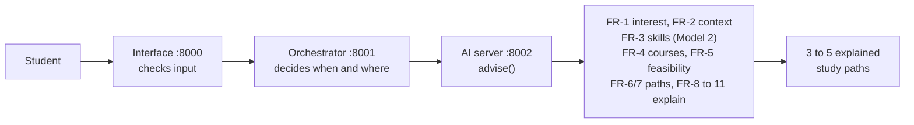

# Software-Engineering---Group-7

SE4CSAI course project, Tilburg University — **study-path advisor**.

A student describes an interest in their own words; the system returns a few coherent
study paths, each with concrete courses and the skills they lead to. The system narrows
and explains — it does not enrol or apply on anyone's behalf.

The part that needs intelligence: student interests and course descriptions are
inconsistent free text written for different purposes, and no fixed rule maps one onto
the other.

**Group 7:** Musaed Al-Fareh, Melat Assefa, Alexia Cobzaru, Raluca Costache,
Mohamed Elshami, Bilgin Eren.

## Start here

New to the code, or preparing for the presentation? Read
**[`docs/HOW_IT_WORKS.md`](docs/HOW_IT_WORKS.md)**: the whole project from data to servers,
with diagrams, one real request followed step by step, a glossary and likely questions.



| I want to … | Go to |
|---|---|
| understand how it all works | [`docs/HOW_IT_WORKS.md`](docs/HOW_IT_WORKS.md) |
| know what each code file and function does | [`src/README.md`](src/README.md) |
| run the servers, the batch preparation or the bias check | [`scripts/README.md`](scripts/README.md) |
| know which test checks what | [`tests/README.md`](tests/README.md) |
| see the server API and the orchestrator's decisions | [`tasks/task6/README.md`](tasks/task6/README.md) |
| see who did what, card by card | [`docs/SPRINT_LOG.md`](docs/SPRINT_LOG.md) |
| read the requirements | [`tasks/task3/`](tasks/task3/) (SRS v3 is the latest) |

Quick try (repo root, `conda activate CSAI`):

```bash
python -m pytest -q                       # 281 tests, ~1 min
python scripts/run_servers.py --check     # start all servers, send a real request, stop: PASSED
```

## Status

Each task has its own folder under `tasks/` with the deliverables and a README that
summarises the assignment, the rubric and the lecturer's feedback.

| Task | Due | Status | Folder |
|---|---|---|---|
| 1 — Problem definition, goals, measurements | 11 Sep | submitted, then revised after lecturer feedback | [`tasks/task1/`](tasks/task1/) |
| 2 — From data to AI | 25 Sep | submitted; revised to v2 after lecturer feedback (1 Oct) | [`tasks/task2/`](tasks/task2/) |
| 3 — Analysis (SRS) | 9 Oct | submitted; revised to v2 after lecturer feedback (20 Oct) | [`tasks/task3/`](tasks/task3/) |
| 4 — Project management and implementation | 23 Oct | submitted late (26 Oct) | [`tasks/task4/`](tasks/task4/) |
| 5 — Implementation and testing | 6 Nov | report submitted 6 Nov; all 8 planned tests pass; demonstrated 9 Nov | [`tasks/task5/`](tasks/task5/) |
| 6 — Scaling up | 13 Nov | done: interface, orchestrator and AI servers on `main`; after the 17 Nov feedback the orchestrator pushes jobs and starts, checks and restarts the AI servers | [`tasks/task6/`](tasks/task6/) |
| 7 — Wrap up | 23 Nov (moved by the lecturer from 20 Nov) | final report in progress; added: path explanation (FR-8 to FR-11), re-evaluate on change (FR-12), bias check (AIR-6), SRS v3, Model 2 re-run | [`tasks/task7/`](tasks/task7/) |

## Repository layout

```
data/                         source tables — read-only for everything except the
│                             cleaning notebooks that live alongside them
├── Online_Courses.csv            raw MOOC catalogue export
├── skills_en.csv                 raw ESCO skills export
├── ISCOGroups_en.csv             raw ISCO-08 hierarchy export
├── occupationSkillRelations_en.csv  raw ESCO occupation ↔ skill links
├── Online_Courses_ml_features.csv   cleaned course table — Model 1 input
├── skills_clean.csv              cleaned ESCO tables — Model 2 index
├── occupations_clean.csv
├── relations_clean.csv
├── isco_clean.csv
└── *.ipynb                       the notebooks that produced the cleaned tables
data/processed/               everything derived from the source tables
├── train.csv, dev.csv, test.csv  the frozen split
├── split_manifest.json           seed + checksums the split is verified against
├── split_report.md, profile_*    data profiling
└── model1_*, model2_*            model results, figures, saved pipelines
src/                          the system's code — see src/README.md
├── data_contract.py              single source of truth: paths, columns, labels, seed
├── advisor.py                    advise(): the whole FR-1 → FR-11 chain, JSON in and out
├── interest.py … explain.py      one module per step (FR-1 … FR-11)
├── model_category.py             Model 1; model_skills.py: Model 2; thresholds.py: FR-13
├── interface_server.py           Task 6 interface server (port 8000)
└── servers/                      Task 6 orchestrator (8001, with its AI pool) and AI server (8002)
config/thresholds.json        the AI thresholds (FR-13)
scripts/                      run_servers.py, prepare_catalogue.py, bias_eval.py, … — see scripts/README.md
notebooks/                    model1_classifier.ipynb, model2_esco_matcher.ipynb
tests/                        automated tests (pytest) — see tests/README.md
docs/                         HOW_IT_WORKS.md, INTERFACES.md, SPRINT_LOG.md
tasks/task1/ … tasks/task7/   one folder per task: deliverables + README
environment.yml               conda environment (CSAI)
```

## Setup and reproducing results

```bash
conda env create -f environment.yml
conda activate CSAI

python -m pytest tests -q          # all tests, including the frozen split against its manifest
```

Run the model notebooks **from the repo root** — see `notebooks/README.md` for the
order and the one setting (`ESCO_SOURCE`) that has to be chosen in Model 2.
`scripts/make_split.py` rebuilds the split, but **do not re-run it casually**: every
reported number depends on the committed split, and the test fails if it changes.

## Working agreements

- **Source tables are read-only.** Only the cleaning notebooks in `data/` write there.
  Everything derived — the split, profiling, model results — goes to `data/processed/`.
- **The split is frozen and committed.** `train.csv`, `dev.csv`, `test.csv` and
  `split_manifest.json` are checked in on purpose: everyone trains and evaluates on the
  same rows, or no two results are comparable. `tests/test_frozen_split.py` fails if the
  files no longer match the manifest.
- **Paths come from `src/data_contract.py`.** Scripts, notebooks and tests all import
  their paths from there, so a file only ever needs moving in one place.
- **Numbers come from files, not from notebook cells.** Anything quoted in a report is
  written to `data/processed/` by the script or notebook that produced it.
- **What is committed is deliberate.** `.gitignore` lists each committed output
  explicitly; everything else under `data/processed/` is regenerated.

## Documents

| File | What it is |
|---|---|
| `docs/HOW_IT_WORKS.md` | the whole project explained, with diagrams — **start here** |
| `src/README.md`, `scripts/README.md`, `tests/README.md` | what each file, function, script and test does |
| `docs/INTERFACES.md` | the agreed module interfaces (`classify`, `match`, thresholds) |
| `docs/SPRINT_LOG.md` | what was done per sprint, by whom, and how it is tested |
| `tasks/task2/MODEL_PLAN.md` | guide for the modelling work in Task 2 |
| `tasks/task2/PIPELINE_AUDIT.md` | audit of the data and model pipeline |
| `tasks/task2/TASK2_REPORT.md` | source text of the Task 2 report |


## Data

| File | Rows | Contents |
|---|---:|---|
| `Online_Courses.csv` | 8,092 | raw MOOC catalogue, 45 columns, four sites |
| `Online_Courses_ml_features.csv` | 5,275 | cleaned and deduplicated, 24 columns |
| `skills_en.csv` | 13,960 | ESCO skills pillar, full export |
| `skills_clean.csv` | 2,154 | skills linked to the selected occupations |
| `occupations_clean.csv` | 319 | ESCO occupations, ISCO major group 2 |
| `relations_clean.csv` | 8,376 | occupation ↔ skill links for those occupations |
| `ISCOGroups_en.csv` / `isco_clean.csv` | 619 | ISCO-08 occupation hierarchy |
| `occupationSkillRelations_en.csv` | 126,051 | all ESCO occupation ↔ skill links |

Only the Coursera rows in the catalogue carry a `Category` label, so the supervised
problem is defined on that subset: 2,577 courses after deduplication, split
1,805 / 386 / 386 with seed 42.

Reuse of these datasets needs to be cleared with the lecturer, as the brief requires.
