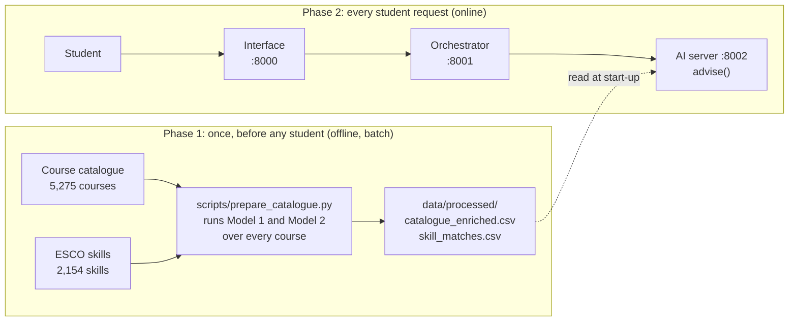
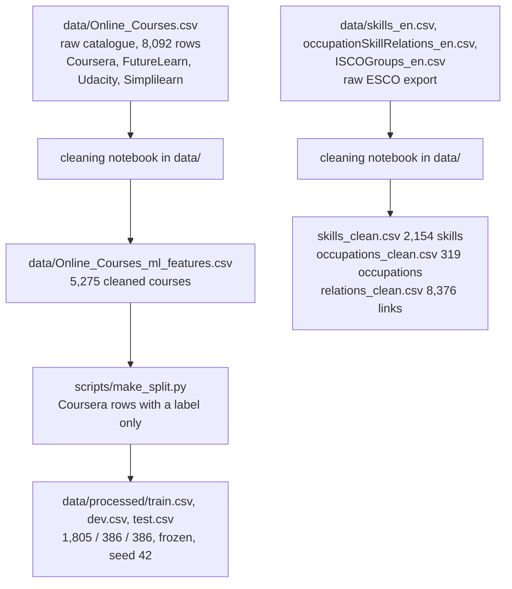
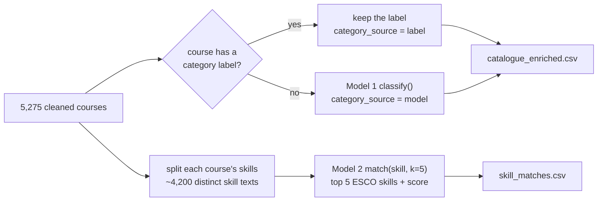
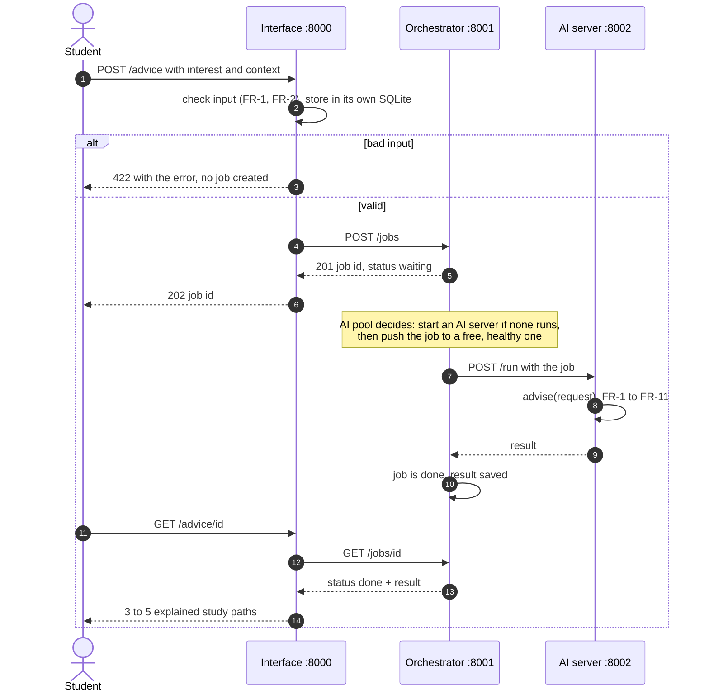
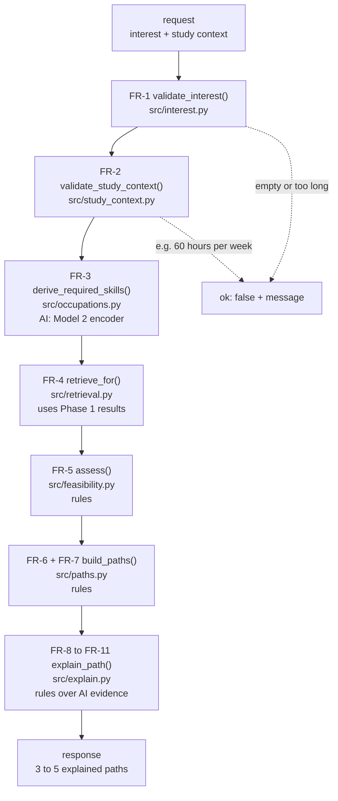
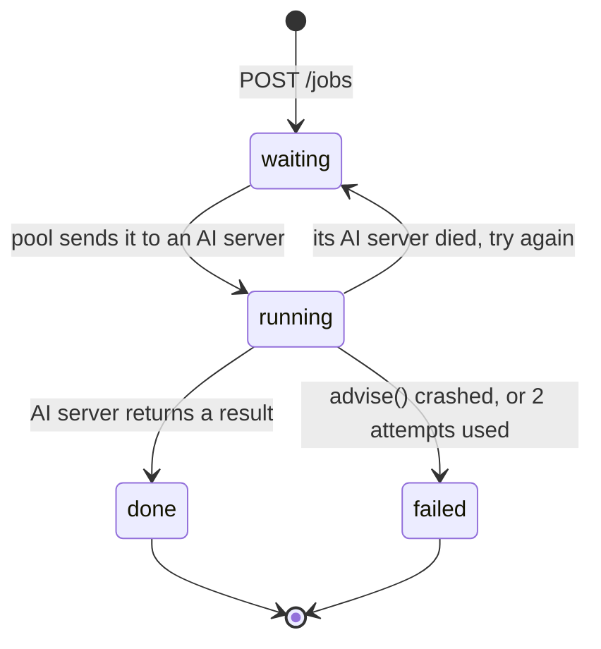
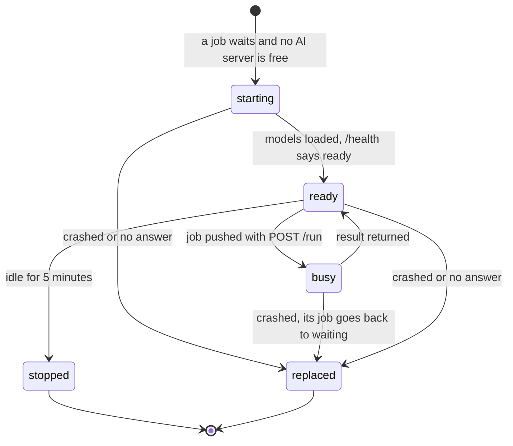
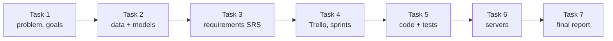

# How the study-path advisor works

A walk-through of the whole project, from the data to the servers, for everyone in the
group. Read it top to bottom once; after that, use the table of contents to jump to the
part you are asked about. Every claim points to the file where it happens, so you can open
the code and check.

**Contents**

1. [The project in one minute](#1-the-project-in-one-minute)
2. [The big picture: two phases](#2-the-big-picture-two-phases)
3. [The data](#3-the-data)
4. [The two AI models](#4-the-two-ai-models)
5. [Phase 1, before any student: preparing the catalogue](#5-phase-1-before-any-student-preparing-the-catalogue)
6. [Phase 2, one student request: the servers](#6-phase-2-one-student-request-the-servers)
7. [Inside `advise()`: the pipeline step by step](#7-inside-advise-the-pipeline-step-by-step)
8. [What the student gets back](#8-what-the-student-gets-back)
9. [The orchestrator in detail](#9-the-orchestrator-in-detail)
10. [Thresholds: when the AI stays silent](#10-thresholds-when-the-ai-stays-silent)
11. [Testing](#11-testing)
12. [How the tasks map to the repository](#12-how-the-tasks-map-to-the-repository)
13. [Run it yourself](#13-run-it-yourself)
14. [Glossary](#14-glossary)
15. [Questions you may get at the presentation](#15-questions-you-may-get-at-the-presentation)

---

## 1. The project in one minute

**Problem.** Students pick electives and courses on their own and often find out too late
that their choices did not prepare them for the job they want.

**What we built.** A student types an interest in their own words (e.g. *"data analyst"*)
plus their study context (language, hours per week, weeks available, courses already
done). The system returns **3–5 study paths**: sets of online courses that fit in the time
they have, each with the skills it teaches, the jobs it leads to and the skills still
missing.

**Where the AI is.** Only where no fixed rule works: understanding free text.
- **Model 1** reads a course description and says which of 11 categories it belongs to.
- **Model 2** compares texts by meaning, so "data extraction" in a course can be linked to
  the official ESCO skill "data mining", and "data analyst" to ESCO occupations.

Everything else (removing courses that do not fit, building paths, ranking them) is plain
rules, because rules are predictable and easy to explain.

**How it runs.** Three separate servers that talk over HTTP: an **interface** (port 8000)
that students talk to, an **orchestrator** (8001) in the middle that decides when and
where work runs, and **AI servers** (8002+) that run the models.

---

## 2. The big picture: two phases

The work is split in two, so a student never waits for slow work:



- **Phase 1** is slow (about 105 s) but runs once: it classifies every course and links
  every course skill to ESCO, and saves the result.
- **Phase 2** only *looks up* those saved results, plus one fast Model 2 call for the
  student's own interest. A request takes about 0.1 s once the models are loaded.

---

## 3. The data



| Dataset | What it is | Used for |
|---|---|---|
| **Online Courses** (Kaggle) | online courses with title, intro, skills, duration, language, site | the courses we recommend |
| **ESCO** (European Commission) | the official list of skills and occupations, and which skills each occupation needs | the "official" skills and jobs we match to |
| **ISCO** | international grouping of occupations | we keep ISCO major group 2 (professionals): 319 occupations |

Things to know:
- Only **Coursera** courses carry a category label (2,577 after removing duplicates), so
  Model 1 is trained on those and predicts a category for the rest.
- **60% of courses list no skills**, so only about 40% of the catalogue can be found by
  skill (FR-4).
- The train/dev/test split is **frozen**: committed with checksums, and
  `tests/test_frozen_split.py` fails if anyone changes it. Every reported number uses the
  same rows.
- All file paths and column names live in one place: `src/data_contract.py`.

---

## 4. The two AI models

### Model 1: course → category (FR-14, AIR-1) · `src/model_category.py`

| | |
|---|---|
| **Input** | course title + ". " + short intro |
| **Output** | one of 11 categories (Business, Computer Science, Data Science, …) and a confidence 0–1 |
| **How** | TF-IDF (turns text into word counts weighted by how rare each word is) + Logistic Regression |
| **Trained on** | 1,805 labelled Coursera courses (`notebooks/model1_classifier.ipynb`) |
| **Result** | test accuracy **0.795**, macro-F1 **0.772** (majority-class baseline: macro-F1 0.044) |
| **Why this model** | we also tried a neural network (MLP); it overfitted the small data and scored lower |
| **Saved as** | `data/processed/model1_tfidf-logreg.joblib`, loaded once by `load_model()` |

### Model 2: text → ESCO skill or occupation (FR-15, AIR-2) · `src/model_skills.py`

| | |
|---|---|
| **Input** | any short text: a course skill ("data extraction") or the student's interest |
| **Output** | the top-k ESCO skills (or occupations), each with a similarity score 0–1 |
| **How** | a pretrained sentence encoder, **all-MiniLM-L6-v2**, turns each text into a vector of 384 numbers; texts with similar meaning get similar vectors; we compare them with **cosine similarity** |
| **Index** | every ESCO skill is encoded once as "preferred label . alt label . alt label …" (`build_index()`) |
| **Result** | the right ESCO skill is in the top 5 for **92.9%** of held-out synonyms (top-1 0.770) |
| **Baseline** | exact string matching finds only ~4% of course skills in ESCO; that is why we need AI |
| **Not trained by us** | we use the pretrained encoder as is; we only build the index |

> The 92.9% replaced an earlier 96.2%: on 20 Nov we found the notebook read each skill's
> synonyms as one label, which made the test too easy (PR #45, `docs/SPRINT_LOG.md`).

The same encoder and the same functions are reused for occupations in
`src/occupations.py` (FR-3).

---

## 5. Phase 1, before any student: preparing the catalogue

`scripts/prepare_catalogue.py` (FR-14, FR-15, NFR-4, AIR-8) runs both models over the
whole catalogue **once**:



- Scores are saved **raw**; thresholds are applied later, when results are used (section 10).
- Run time: about 105 s. Tested by I3 (`tests/test_integration_i3_batch_catalogue.py`),
  which also checks that a live lookup takes < 500 ms (AIR-8).

---

## 6. Phase 2, one student request: the servers

Task 6 asked for a distributed system: an interface, one or more AI servers, and an
orchestrator between them, where **the interface never calls the AI directly**.



| Server | File | Owner | What it does |
|---|---|---|---|
| **Interface** :8000 | `src/interface_server.py` | Melat | the only server students talk to; checks input, stores requests, forwards valid ones; also lets students update a request (FR-12) and flag a wrong match (FR-17) |
| **Orchestrator** :8001 | `src/servers/orchestrator.py` + `src/servers/ai_pool.py` | Musaed | job queue in SQLite; decides when and where each job runs; checks, restarts, starts and stops AI servers |
| **AI server** :8002+ | `src/servers/ai_server.py` | Mohamed | loads both models once, then waits; runs `advise()` when the orchestrator sends a job |
| **Start script** | `scripts/run_servers.py` | Bilgin | starts everything with one command and runs an end-to-end check |

**Endpoints** (full details in `tasks/task6/README.md`):

| Server | Endpoint | What for |
|---|---|---|
| Interface | `POST /advice` | ask for advice → job id |
| Interface | `GET /advice/{id}` | status, and the result when done |
| Interface | `POST /advice/{id}/update` | change some inputs, get new advice (FR-12) |
| Interface | `POST /flags` | report a wrong skill or occupation (FR-17), no personal data |
| Orchestrator | `POST /jobs`, `GET /jobs/{id}` | used by the interface only |
| Orchestrator | `GET /health` | jobs per status, AI servers and their state |
| AI server | `POST /run`, `GET /health` | used by the orchestrator only |

---

## 7. Inside `advise()`: the pipeline step by step

`src/advisor.py` puts every step behind one function, `advise(request) -> response`. Plain
JSON in, plain JSON out, so the AI server just passes it through.



Followed with one real request: **"data analyst", English, 6 hours per week, 20 weeks**.

| Step | File · function | What happens | AI or rule | Example |
|---|---|---|---|---|
| **FR-1** capture interest | `interest.py` · `validate_interest()` | 1–500 characters, trimmed; empty → "Please describe an interest" | rule | "data analyst" ✓ |
| **FR-2** study context | `study_context.py` · `validate_study_context()` | language text, 1–40 hours, 1–52 weeks, list of completed courses; a missing field becomes "not given" and its check is skipped | rule | completed courses: "not given" |
| **FR-3** required skills | `occupations.py` · `derive_required_skills()` | the interest is compared with the 319 ESCO occupations; up to 3 with score ≥ 0.55 are kept; their essential skills become the **required skills**. None ≥ 0.55 → "no occupation matched", and FR-4 uses the interest text itself | **AI** (Model 2 encoder) | ICT test analyst 0.626, data scientist 0.614, insurance rating analyst 0.612 → 85 required skills |
| **FR-4** candidate courses | `retrieval.py` · `retrieve_for()` | uses Phase 1's `skill_matches.csv`: a course is a candidate if one of its skills links (score ≥ 0.45) to a required skill; ranked by how many it covers; max 50 | lookup of AI results | up to 50 courses |
| **FR-5** feasibility | `feasibility.py` · `assess()` | removes courses already completed, in another language, or needing more hours per week than the student has; each with its reason. A course with a missing value is kept ("not listed") | rule | "Google Data Analytics … needs 10 hours per week, you have 6" |
| **FR-6** compose paths | `paths.py` · `build_paths()` / `compose_path()` | each path starts from a different course and keeps adding the course that covers the most **still missing** required skills, while the total fits the weeks available (max 5 courses). Durations become weeks: months × 4.3, hours ÷ hours per week | rule | path of 19.4 weeks |
| **FR-7** rank | `paths.py` · `build_paths()` | **fit** = share of required skills covered; highest first, ties to the shorter path; return 3–5, or fewer with "only N paths fit your constraints" | rule | best fit 0.306 |
| **FR-8** what it opens | `explain.py` · `occupations_opened()` | up to 5 occupations whose essential skills the path covers best, ranked by count × share | rule over AI links | data analyst 19/36 (0.53), data scientist 25/63 |
| **FR-9** what it closes off | `explain.py` · `skill_gaps()` | required skills the path does not cover: first 10 + total | rule | "levels of software testing" … 59 in total |
| **FR-10** why each course | `explain.py` · `explain_course()` | each skill the course brings, traced to the course's own text and the similarity score (AIR-5) | shows AI evidence | "data extraction" → data mining, 0.618 |
| **FR-11** duration | `explain.py` · `duration_text()` | the listed duration and its weeks; "not listed" if missing | rule | "3 months" = 12.9 weeks |

Why "ICT test analyst" for "data analyst"? Model 2 compares meaning, and "analyst" pulls
in other analyst jobs above the 0.55 threshold. That is why the paths' missing skills
include software testing. A known limitation; see section 15.

**Other features around `advise()`:**
- **FR-12 re-evaluate on change** · `interface_server.py` · `update_advice()`: the student
  sends only what changed; the interface reuses the rest of the earlier request and starts
  a new job.
- **FR-13 withhold low confidence** · `thresholds.py`: see section 10.
- **FR-17 report a wrong match** · `interface_server.py` · `post_flag()`: stores the flag
  with a timestamp and no personal data (NFR-8).
- **AIR-6 bias check** · `scripts/bias_eval.py`: section 11.

---

## 8. What the student gets back

A real response, shortened (`…` = more items):

```json
{
  "ok": true,
  "interest": "data analyst",
  "context": {"language": "English", "hours_per_week": 6.0, "weeks_available": 20.0,
              "completed_courses": "not given"},
  "occupations": [{"label": "ICT test analyst", "score": 0.626},
                  {"label": "data scientist", "score": 0.614}, …],
  "required_skills": ["levels of software testing", "set quality assurance objectives", …],
  "paths": [
    {
      "fit": 0.306,
      "weeks": 19.4,
      "courses": [{"title": "Data Analysis and Visualization with Microsoft Power BI",
                   "category": "Data Science", "skills": ["data mining", "data models", …]}, …],
      "covered_skills": ["data engineering", "data ethics", "data mining", …],
      "opens": [{"occupation": "data analyst", "skills_covered": 19,
                 "essential_skills": 36, "share": 0.528}, …],
      "closes": ["levels of software testing", "set quality assurance objectives", …],
      "closes_total": 59,
      "course_details": [{"duration": "3 months", "weeks": 12.9,
                          "category_from": "Model 1 prediction",
                          "skill_links": [{"esco_skill": "data mining",
                                           "from_course_skill": "data extraction",
                                           "similarity": 0.618}, …]}, …]
    }, …
  ],
  "score_note": "Scores are cosine similarities (0-1) between texts, not probabilities of being correct.",
  "removed": [{"title": "Google Data Analytics Professional Certificate",
               "reason": "needs 10 hours per week, you have 6"}, …],
  "left_out_no_duration": 0,
  "message": null
}
```

| Field | Meaning | Requirement |
|---|---|---|
| `occupations` | the ESCO jobs the interest matched, with score | FR-3 |
| `required_skills` | the skills those jobs need | FR-3 |
| `paths[].fit` | share of the required skills this path covers (0–1) | FR-7 |
| `paths[].weeks` | total length of the path | FR-6, FR-11 |
| `paths[].covered_skills` | required skills the path does cover | FR-7 |
| `paths[].opens` | jobs the path leads to | FR-8 |
| `paths[].closes` / `closes_total` | required skills still missing | FR-9 |
| `course_details[].skill_links` | why each course is there, with the evidence | FR-10, AIR-5 |
| `course_details[].duration` | course length, or "not listed" | FR-11, NFR-3 |
| `category_from` | catalogue label or Model 1 prediction | AIR-5 |
| `removed` | courses taken out, each with the reason | FR-5 |
| `message` | why there are fewer than 3 paths, if so | FR-7 |

Bad input gives `{"ok": false, "error": "Please describe an interest"}`, and the interface
answers 422 without creating a job.

---

## 9. The orchestrator in detail

The lecturer's feedback on our first Task 6 version (17 Nov): the middle server was only a
**queue** that the AI server kept asking for work. A real orchestrator **decides**. So now
the orchestrator's AI pool (`src/servers/ai_pool.py`) runs a loop (`tick()`, every 0.5 s or
as soon as a job arrives) that does four things:

| Decision | What it does |
|---|---|
| **Dispatch** | sends the oldest waiting job to a free, healthy AI server (`POST /run`) |
| **Health** | checks every AI server every 5 s (`GET /health`, and is its process alive?) |
| **Recover** | an AI server that crashes or stops answering is removed; its job goes back to waiting and runs elsewhere (max 2 attempts, then failed) |
| **Scale** | starts an AI server when jobs wait and none is free (max 2); stops one idle for 5 min; with no jobs, none runs |

**A job's life** (`JobQueue` in `src/servers/orchestrator.py`, stored in SQLite):



**An AI server's life** (managed mode, the default):



**Two writers on one database row?** Not possible: the interface has its own database, the
orchestrator is the only one that writes the job table, every change is one
`BEGIN IMMEDIATE` transaction, and a job is handed out once (tested with 8 parallel takers).

**Two modes.** *Managed* (default): the orchestrator starts AI server processes itself.
*External*: `AI_SERVERS=http://host1:8002,http://host2:8002` lists AI servers running
elsewhere (e.g. other machines); the orchestrator checks and uses them but cannot start them.

Settings (environment variables): `AI_MAX_WORKERS` (2), `AI_MIN_WORKERS` (0),
`AI_IDLE_STOP_SECONDS` (300), `AI_JOB_TIMEOUT` (120), `JOB_MAX_ATTEMPTS` (2),
`AI_BASE_PORT` (8002), `ORCHESTRATOR_DB`.

---

## 10. Thresholds: when the AI stays silent

AI scores are not always right, so below a threshold we **do not use** the AI output
(FR-13, AIR-3). The values are in `config/thresholds.json`; `src/thresholds.py` reads them
(`load_thresholds()`) and compares (`passes(score, kind)`, score ≥ threshold).

| Kind | Threshold | Below it | Why this value |
|---|---:|---|---|
| category (Model 1) | 0.20 | "uncategorised" | on the dev set, predictions below 0.20 were right only 47.5% of the time; the 85% kept are 86.5% right |
| occupation (FR-3) | 0.55 | "no occupation matched", fall back to the interest text | measured with the real encoder (`docs/SPRINT_LOG.md`) |
| skill and retrieval (FR-4, FR-15) | 0.45 | the link is not used | measured with the real encoder |

---

## 11. Testing

**281 tests**, all passing; GitHub Actions runs them on every push
(`.github/workflows/tests.yml`). See `tests/README.md` for the full list.

- **Unit tests** replace the models with small fakes, so they are fast and a failure points
  at our own code.
- **Integration tests** use the real models and data, no fakes.
- **Server tests** run the real FastAPI apps in memory; `tests/test_servers_integration.py`
  runs interface → orchestrator → AI server together.

The 8 tests planned in Task 5:

| ID | Requirement | What it checks | File |
|---|---|---|---|
| U1 | FR-1 | interest accepted / refused | `test_interest.py` |
| U2 | FR-2, NFR-3 | hours, weeks, language limits; "not given" | `test_study_context.py` |
| U3 | FR-13, AIR-3 | a score exactly at the threshold is kept | `test_thresholds.py` |
| U4 | FR-14, AIR-1 | `classify()` with a fake model | `test_model_category.py` |
| U5 | FR-15, AIR-2 | `match()` with a fake encoder | `test_model_skills.py` |
| I1 | FR-13, FR-14 | real Model 1 + threshold | `test_category_threshold_integration.py` |
| I2 | FR-13, FR-15 | real encoder: ≥ 85% in top 5 | `test_i2_skill_matching.py` |
| I3 | FR-4, AIR-8 | batch preparation, lookups < 500 ms | `test_integration_i3_batch_catalogue.py` |

**Bias check (AIR-6)** · `scripts/bias_eval.py` (Bilgin, PR #48): 48 pairs of inputs that
differ only in a personal detail ("I am a woman" / "I am a man", age 18 / 55, from the
Netherlands / from Morocco). Result (`data/processed/bias_eval.md`): **24 of 48 pairs give
different advice**. Gender and origin lean one way consistently ("I am a woman. web
developer" → 0 paths, "I am a man. web developer" → 5). The cause is the pretrained
encoder, which is why AIR-6 says such differences must be resolved before adoption, e.g. by
removing self-descriptions from the interest before matching.

---

## 12. How the tasks map to the repository



| Task | Report in | Code it produced |
|---|---|---|
| 1 Problem, goals, measurements | `tasks/task1/` | — |
| 2 From data to AI | `tasks/task2/` | `data/*.ipynb`, `scripts/make_split.py`, `profile_data.py`, `data_resources.py`, `notebooks/` |
| 3 Requirements (SRS v1, v2, v3) | `tasks/task3/` | — (every module names the FR / NFR / AIR it implements) |
| 4 Project management | `tasks/task4/` | Trello board, `docs/INTERFACES.md` |
| 5 Implementation and testing | `tasks/task5/` | `src/*.py` modules, `scripts/prepare_catalogue.py`, `tests/` |
| 6 Scaling up | `tasks/task6/` | `src/interface_server.py`, `src/servers/`, `scripts/run_servers.py` |
| 7 Wrap up | `tasks/task7/` | `src/explain.py` (FR-8–11), FR-12, `scripts/bias_eval.py`, SRS v3 |

Who did what, card by card: `docs/SPRINT_LOG.md`.

---

## 13. Run it yourself

From the repo root, in the CSAI environment (`conda activate CSAI`):

```bash
python -m pytest -q                     # all tests (~1 min)
python scripts/run_servers.py --check   # start the 3 servers, send real requests, stop: prints PASSED
python scripts/run_servers.py           # start them and leave them running (Ctrl+C stops)
```

With the servers running, ask for advice like a student:

```bash
curl -X POST localhost:8000/advice -H "content-type: application/json" \
     -d '{"interest": "data analyst", "hours_per_week": 6, "weeks_available": 20}'
# -> {"id": "<id>", "status": "waiting"}
curl localhost:8000/advice/<id>      # after ~20 s the first time (models load), then instantly
curl localhost:8001/health           # what the orchestrator is doing
```

Or open **http://localhost:8000/docs** in a browser: FastAPI's page where you can try every
endpoint by clicking "Try it out".

Or call the pipeline directly in Python, without servers:

```python
from src.advisor import advise
advise({"interest": "data analyst", "hours_per_week": 6, "weeks_available": 20})
```

---

## 14. Glossary

| Term | Meaning |
|---|---|
| **ESCO** | European Skills, Competences, Qualifications and Occupations: the EU's official list of skills and jobs, and which skills each job needs |
| **ISCO** | International Standard Classification of Occupations; we use major group 2, professionals |
| **Interest** | what the student types, e.g. "data analyst" |
| **Required skills** | the essential ESCO skills of the occupations the interest matched (FR-3) |
| **Study path** | a set of up to 5 courses that fits in the weeks available |
| **Fit** | share of the required skills a path covers, 0–1 |
| **TF-IDF** | turns text into numbers: each word weighted by how often it appears here and how rare it is overall |
| **Logistic Regression** | a simple, fast classifier; Model 1 |
| **Sentence encoder / embedding** | a pretrained neural network that turns a sentence into a vector of numbers; similar meaning → similar vectors |
| **Cosine similarity** | how close two vectors point, 0–1 here; our "score". Not a probability |
| **Threshold** | the minimum score for an AI output to be used (section 10) |
| **Macro-F1** | average F1 over the 11 categories, so small categories count as much as big ones |
| **Top-5 / MRR@5** | right answer among the first 5 results / how high it ranks on average |
| **Baseline** | the simplest possible method, to show the model is better (majority class, exact match) |
| **Frozen split** | train/dev/test rows fixed once and checked by a test, so results stay comparable |
| **FastAPI / uvicorn** | the Python web framework our servers use / the program that runs them |
| **Orchestrator** | the server in the middle that decides when and where jobs run |
| **Health check** | a quick "are you alive and ready?" request (`GET /health`) |
| **SQLite** | a small database stored in one file |
| **CI** | Continuous Integration: GitHub Actions runs all tests on every push |
| **FR / NFR / AIR / UR** | functional / non-functional / AI-specific / user requirement, numbered in the SRS |

---

## 15. Questions you may get at the presentation

**Why use AI at all?** Course texts and ESCO use different words for the same thing. Exact
matching links only ~4% of course skills to ESCO. Model 2 links by meaning.

**Why only AI for interpretation, not for the whole recommendation?** Feasibility (hours,
language, weeks) is fixed by the student's situation, so rules are exact, predictable and
easy to explain. AI is used only where no rule works.

**Why Logistic Regression and not a neural network?** We tried an MLP: it overfitted the
1,805 training courses and had lower macro-F1 (0.724 vs 0.752 on dev). The simple model is
better, faster (0.6 s to train) and easier to explain.

**Did you train Model 2?** No. We use a pretrained sentence encoder (all-MiniLM-L6-v2) and
build an index of ESCO skills with it. We evaluated it on held-out ESCO synonyms: 92.9% in
the top 5.

**How do you know the models are good enough?** Each has a baseline (majority class: 0.044
macro-F1; exact match: ~0% top-1) and the models are far above it. Thresholds hide the
uncertain answers.

**What happens if the AI is unsure?** Below the threshold the output is not used:
"uncategorised", "no occupation matched", or the skill link is dropped (FR-13).

**Why are the results sometimes odd ("data analyst" → "ICT test analyst")?** The encoder
compares meaning, and "analyst" is close to other analyst jobs. The threshold is a trade-off
between finding something and finding only the right thing.

**Why three servers?** Task 6 required it. It also lets the AI part (slow to start, heavy)
be started, stopped and replaced without touching the part students talk to.

**What does the orchestrator do that a queue does not?** It decides: it pushes jobs to AI
servers, checks their health, restarts a crashed one and retries the job, starts one when
work arrives and stops one when idle.

**What if an AI server crashes in the middle of a job?** The health check notices, the job
goes back to waiting and runs on a new AI server (max 2 attempts). We tested this live by
killing the AI server.

**What is stored about students?** The interface stores each checked request (no name or
account) so it can answer status questions and FR-12 updates; flags store no personal data.
SRS v3 updated NFR-8 to say exactly this.

**Is the system fair?** We tested it (AIR-6, `scripts/bias_eval.py`): adding "I am a woman"
or "from Morocco" changes the advice in a consistent direction. It comes from the
pretrained encoder. A fix would be to remove self-descriptions before matching; the test
can be re-run with `--strict` before any new model is adopted.

**What is the environmental cost?** Small for our own AI: training Model 1 takes < 1 s,
the batch preparation ~105 s, one request ~0.1 s. Leaving servers on costs more than
running them; that is one reason the orchestrator stops idle AI servers.

**How did you test it?** 281 automated tests: unit tests with fakes, integration tests with
the real models, server tests, and an end-to-end check (`run_servers.py --check`). CI runs
them on every push, and `main` only accepts reviewed pull requests.

**What would you do next?** Get the real university catalogue (we used an online one), fix
the bias found by AIR-6, add a user interface, and test with real students.
