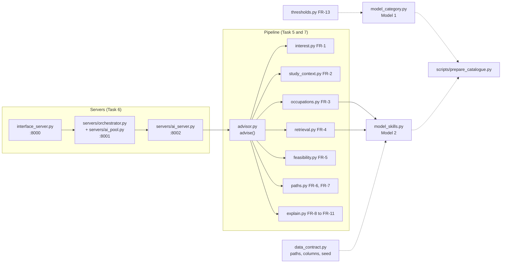

# `src/`: the system's code

One module per requirement step, plus the servers. For the story of how they fit together,
read [`docs/HOW_IT_WORKS.md`](../docs/HOW_IT_WORKS.md) first.



Every module says in its first lines which requirements it implements. Each step can be
given a fake through keyword arguments, so unit tests run without the real models.

## The pipeline, in the order a request goes through it

| File | Requirement | Main functions | In → out |
|---|---|---|---|
| `advisor.py` | FR-1 → FR-11 | `advise(request)` | request dict → response dict; calls every step below |
| `interest.py` | FR-1 | `validate_interest(raw)` | text → `ValidationResult(ok, value, error)`; 1–500 characters |
| `study_context.py` | FR-2, NFR-3 | `validate_study_context(language, hours_per_week, weeks_available, completed_courses)`, `label_missing()` | raw fields → `StudyContext`; missing = "not given" (student) or "not listed" (catalogue) |
| `occupations.py` | FR-3 | `derive_required_skills(interest)`, `match_occupations()`, `skills_for()` | interest → `RequiredSkills(occupations, skills, message)`; up to 3 occupations ≥ 0.55 |
| `retrieval.py` | FR-4 | `retrieve_for(interest, required)`, `course_esco_links()`, `retrieve()`, `skills_from_interest()` | required skills → up to 50 `CourseCandidate`s, most skills covered first; falls back to the interest text if no occupation matched |
| `feasibility.py` | FR-5 | `assess(candidates, context, facts)`, `removal_reason()` | candidates → `FeasibilityResult(kept, removed)`; removed = completed, other language, too many hours |
| `paths.py` | FR-6, FR-7 | `build_paths(candidates, required, context, durations)`, `compose_path()`, `to_weeks()` | feasible courses → 3–5 `StudyPath(courses, covered, weeks, fit)`, best fit first |
| `explain.py` | FR-8 – FR-11, AIR-5 | `explain_path()`, `occupations_opened()`, `skill_gaps()`, `explain_course()`, `duration_text()` | one path → `opens`, `closes`, `closes_total`, `course_details` |

## The AI models and thresholds

| File | Requirement | Main functions | Notes |
|---|---|---|---|
| `model_category.py` | FR-14, AIR-1 | `classify(title, intro) -> (category, confidence)` | Model 1, TF-IDF + Logistic Regression, loaded once from `data/processed/model1_tfidf-logreg.joblib` |
| `model_skills.py` | FR-15, AIR-2 | `match(skill_text, k=5) -> [SkillMatch(esco_id, label, score)]`, `rank()`, `build_index()`, `alt_labels()` | Model 2, all-MiniLM-L6-v2 over the 2,154 ESCO skills; `occupations.py` reuses it for occupations |
| `thresholds.py` | FR-13, AIR-3 | `load_thresholds()`, `passes(score, kind)` | values in `config/thresholds.json`; score ≥ threshold passes |
| `data_contract.py` | — | constants only | every path, column name, label and the seed (42); change a path here and nowhere else |

The models never threshold themselves; the caller decides with `passes()`. The agreed
signatures are in [`docs/INTERFACES.md`](../docs/INTERFACES.md) and guarded by
`tests/test_interfaces.py`.

## The servers (Task 6)

| File | Port | Main parts |
|---|---|---|
| `interface_server.py` | 8000 | `POST /advice` (`check_request()`, `submit()`), `GET /advice/{id}`, `POST /advice/{id}/update` (FR-12, `update_advice()`), `POST /flags` (FR-17, `check_flag()`, `store_flag()`), `GET /health`; own SQLite database |
| `servers/orchestrator.py` | 8001 | `JobQueue` (SQLite job table: `add`, `take_next`, `requeue`, `finish`, `get`, `counts`), `create_app()`, `pool_from_env()`; `POST /jobs`, `GET /jobs/{id}`, `GET /health`, `POST /ai/shutdown` |
| `servers/ai_pool.py` | — | `AIPool.tick()`: dispatch, health checks, recovery, scaling; `SubprocessLauncher` starts AI servers as processes |
| `servers/ai_server.py` | 8002+ | `preload_models()`, `POST /run` (`run_job()`), `GET /health` |

Details of every endpoint and setting: [`tasks/task6/README.md`](../tasks/task6/README.md).

## Try one module on its own

```python
from src.interest import validate_interest
validate_interest("   ")                      # ok=False, error="Please describe an interest"

from src.model_category import classify
classify("Intro to Python", "Learn to program with Python")   # ('Computer Science', 0.28)

from src.model_skills import match
match("data extraction", k=3)   # information extraction 0.78, data mining 0.62, unstructured data 0.58

from src.advisor import advise
advise({"interest": "web developer", "weeks_available": 12})
```

Run from the repo root in the CSAI environment. The first call that needs Model 2 takes
~20 s (loading the encoder and building the indices); later calls are fast.
