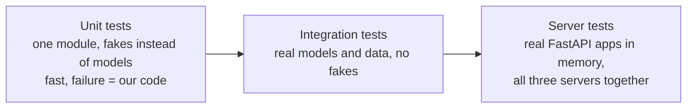

# `tests/`: automated tests (pytest)

**281 tests**, all passing. GitHub Actions runs them on every push and pull request
(`.github/workflows/tests.yml`), and `main` only accepts pull requests with green tests.

```bash
python -m pytest -q                         # everything, ~1 min
python -m pytest tests/test_paths.py -q     # one file
python -m pytest -q -k "not integration"    # skip the slow real-model tests
```

Run from the repo root in the CSAI environment. Tests that need data or models that are
missing are skipped, not failed.

## Three kinds of test



## Which file tests what

| File | Tests | Kind | What |
|---|---:|---|---|
| `test_interest.py` | 7 | unit | **U1** FR-1: interest accepted, trimmed, refused |
| `test_study_context.py` | 36 | unit | **U2** FR-2, NFR-3: hours, weeks, language, "not given" |
| `test_thresholds.py` | 3 | unit | **U3** FR-13: a score exactly at the threshold passes |
| `test_model_category.py` | 9 | unit | **U4** Model 1 `classify()` with a fake model |
| `test_model_skills.py` | 12 | unit | **U5** Model 2 `match()` with a fake encoder |
| `test_category_threshold_integration.py` | 1 | integration | **I1** real Model 1 + threshold |
| `test_i2_skill_matching.py` | 4 | integration | **I2** real encoder: ≥ 85% of synonyms in the top 5 |
| `test_integration_i3_batch_catalogue.py` | 18 | integration | **I3** batch preparation; lookups < 500 ms |
| `test_occupations.py` / `_integration.py` | 9 / 3 | unit / integration | FR-3 required skills |
| `test_retrieval.py` / `_integration.py` | 8 / 3 | unit / integration | FR-4 candidate courses |
| `test_feasibility.py` / `_integration.py` | 7 / 1 | unit / integration | FR-5 removals with reasons |
| `test_paths.py` | 16 | unit | FR-6, FR-7 composing and ranking paths |
| `test_explain.py` | 10 | unit | FR-8 – FR-11 path explanation |
| `test_advisor.py` | 7 | unit | `advise()` with every step faked |
| `test_advisor_integration.py`, `test_advisor_chain_integration.py` | 2, 1 | integration | `advise()` on the real data |
| `test_model_category_integration.py`, `test_model_skills_integration.py` | 8, 4 | integration | both models as modules |
| `test_prepare_catalogue.py` | 10 | unit | batch preparation logic |
| `test_interfaces.py` | 5 | unit | the signatures agreed in `docs/INTERFACES.md` |
| `test_frozen_split.py` | 6 | data | the split still matches its checksums |
| `test_interface_server.py` | 27 | server | interface: checks, storage, FR-12, FR-17 |
| `test_orchestrator.py` | 30 | server | queue + every orchestrator decision, with fake AI servers and a fake clock |
| `test_ai_server.py` | 10 | server | `POST /run`, crash handling, one job at a time |
| `test_servers_integration.py` | 5 | server | interface → orchestrator → AI server together |
| `test_run_servers.py` | 10 | unit | the start script's end-to-end check |
| `test_bias_eval.py` | 9 | unit + integration | AIR-6 bias evaluation |

U1–U5 and I1–I3 are the 8 tests planned in the Task 5 report.

## Writing a new test

- Name the file `test_<module>.py` (unit) or `test_<module>_integration.py` (real models).
- Start it with a docstring naming the requirement, like the existing files.
- In unit tests, pass fakes through the keyword arguments (`advise(request, derive=..., retrieve=...)`)
  instead of loading the models.
